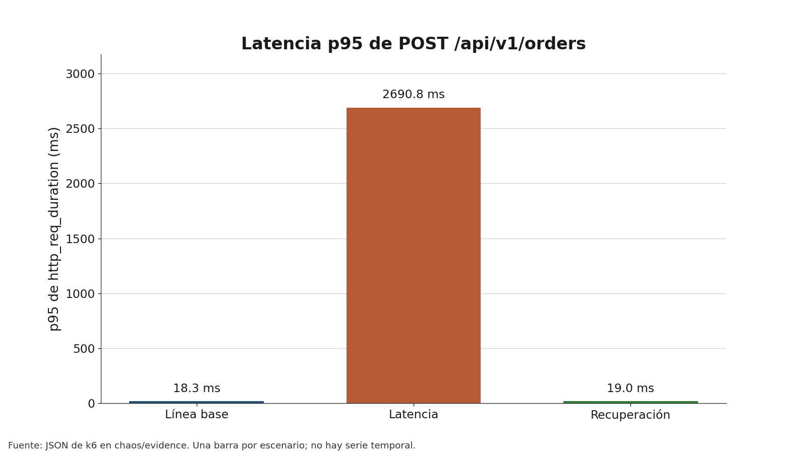
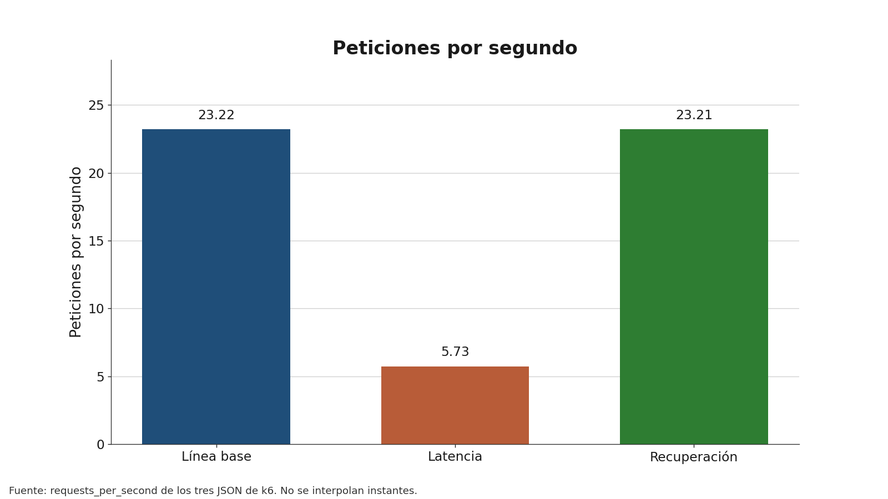
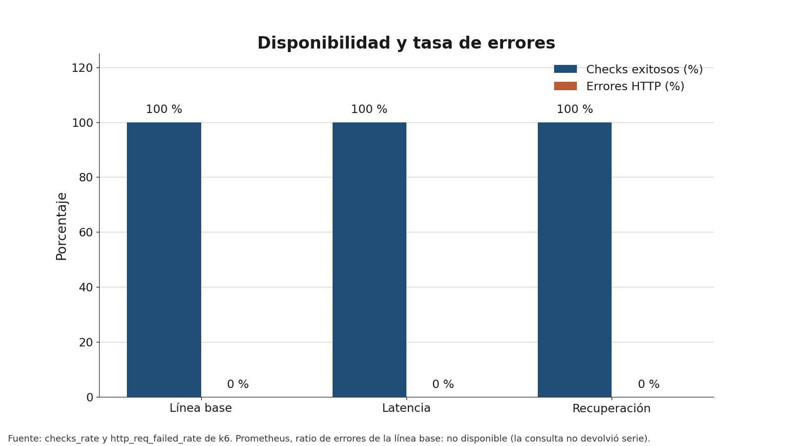
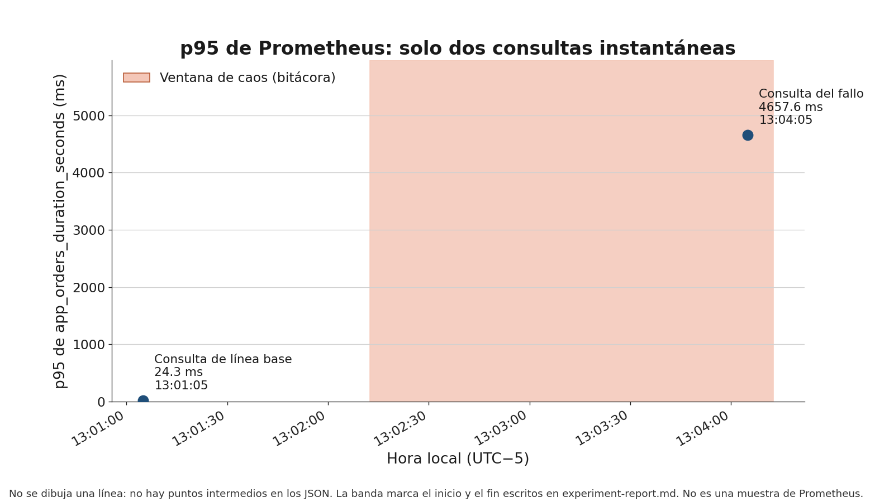
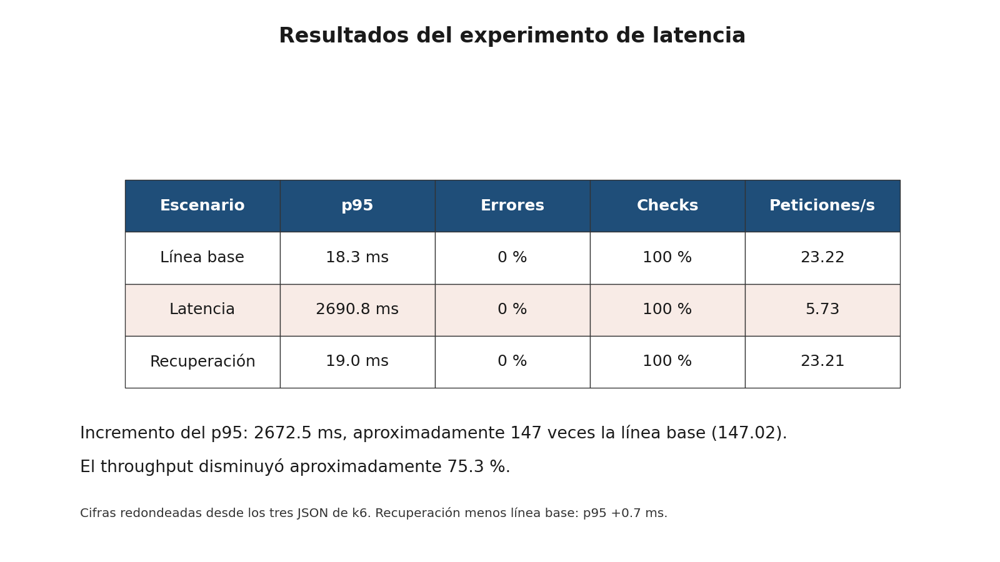

# Índice de evidencias visuales

Figuras generadas desde los JSON de esta carpeta. No son capturas de Grafana, Jaeger, Prometheus ni de la terminal. Esas interfaces no se fabricaron.

Para volver a crearlas, desde `otel-multicloud-lab`:

```powershell
.\.venv\Scripts\python.exe -m pip install -r chaos/requirements-charts.txt
.\.venv\Scripts\python.exe chaos/scripts/generate-evidence-charts.py
```

`matplotlib` está solo en `chaos/requirements-charts.txt`.

## latency-comparison.png



| Campo | Contenido |
| --- | --- |
| Fuente | `baseline-20261018-125909.json`, `latency-20261018-130149.json`, `recovery-20261018-130644.json`, campo `http_req_duration_p95` |
| Requisito | Comparar la latencia p95 de la línea base, el experimento y la recuperación, con unidades |
| Pie sugerido | Figura. p95 de k6 en `POST /api/v1/orders`: 18.3 ms en línea base, 2690.8 ms durante el escenario de latencia y 19.0 ms en la recuperación. Cada barra es un resumen completo, no un instante intermedio. |

## throughput-comparison.png



| Campo | Contenido |
| --- | --- |
| Fuente | Los mismos tres JSON, campo `requests_per_second` |
| Requisito | Mostrar la caída de capacidad durante el fallo y el retorno del ritmo en la recuperación |
| Pie sugerido | Figura. Peticiones por segundo medidas por k6: 23.22 en línea base, 5.73 en latencia y 23.21 en recuperación. |

## availability-comparison.png



| Campo | Contenido |
| --- | --- |
| Fuente | `checks_rate` y `http_req_failed_rate` de los tres JSON de k6. `prometheus-baseline-error-ratio.json` no trae serie y la figura lo indica como no disponible |
| Requisito | Evidenciar que la disponibilidad se mantuvo y que la tasa de errores no subió |
| Pie sugerido | Figura. Checks exitosos al 100 % y errores HTTP al 0 % en los tres escenarios de k6. El ratio de errores de Prometheus para la línea base no está disponible: la consulta guardada no devolvió serie. |

## prometheus-p95-timeline.png



| Campo | Contenido |
| --- | --- |
| Fuente | `prometheus-baseline-p95.json` (13:01:05, 24.3 ms) y `prometheus-latency-p95.json` (13:04:05, 4657.6 ms). La banda usa el inicio 13:02:12.528 y el fin 13:04:12.544 escritos en `experiment-report.md`. No hay más instantes en los JSON |
| Requisito | Situar las dos consultas reales respecto de la ventana de caos, sin interpolar |
| Pie sugerido | Figura. p95 instantáneo de `app_orders_duration_seconds`: 24.3 ms a las 13:01:05 y 4657.6 ms a las 13:04:05. La banda es la ventana anotada en la bitácora, no una serie de Prometheus. El cuantil del fallo cae en el cubo de 2.5 s a 5 s. |

## experiment-summary.png



| Campo | Contenido |
| --- | --- |
| Fuente | Los tres JSON de k6. El incremento, el factor y la caída de throughput se calculan con esos valores |
| Requisito | Tabla de resultados: p95, errores, checks y peticiones por segundo, más el incremento de 2672.5 ms, el factor de aproximadamente 147 y la reducción de throughput de aproximadamente 75.3 % |
| Pie sugerido | Figura. Resumen redondeado del Game Day. El p95 pasó de 18.3 ms a 2690.8 ms (2672.5 ms más, unas 147 veces) y las peticiones por segundo bajaron de 23.22 a 5.73, cerca de un 75.3 %. Errores 0 % y checks 100 % en los tres escenarios. La recuperación quedó en 19.0 ms y 23.21 peticiones/s. |

## JSON que no son figuras

| Archivo | Papel |
| --- | --- |
| `jaeger-latency-traces.json` | Trazas. No se convirtió en gráfica de interfaz. El p95 de esas 20 trazas sigue en la bitácora |
| `jaeger-services.json` | Solo lista `service-a` |
| `prometheus-latency-buckets.json` | Explica por qué el p95 de Prometheus es 4.66 s. No aporta más instantes |
| `prometheus-baseline-success-ratio.json` y `prometheus-latency-success-ratio.json` | Ratio de éxito 1 |
| `prometheus-latency-error-ratio.json` | Ratio de errores 0 durante el fallo |
| `prometheus-baseline-rps.json` y `prometheus-latency-rps.json` | 21.50 y 3.83 peticiones/s. No se mezclaron con k6 en las barras |
